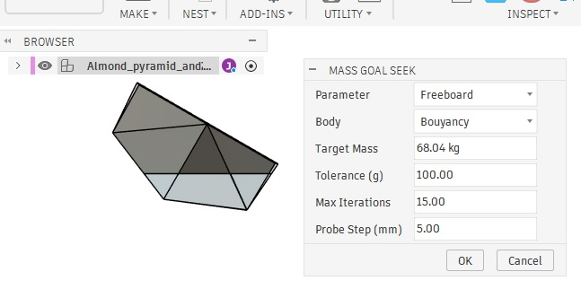
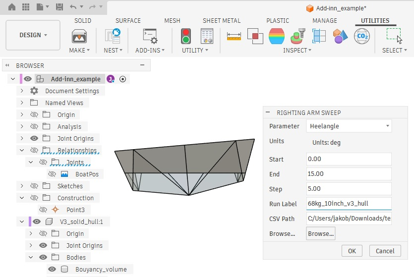
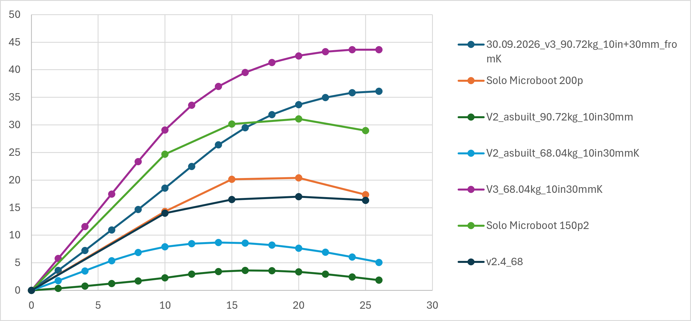
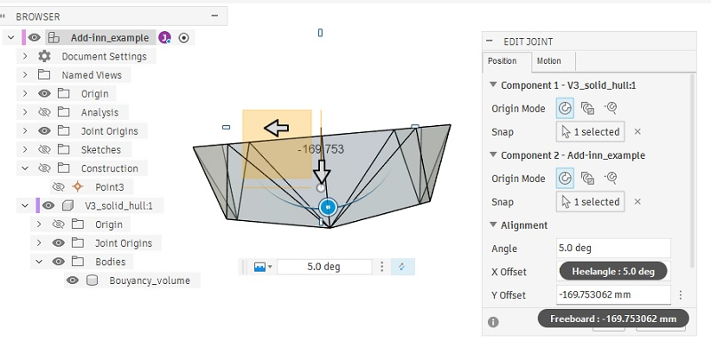
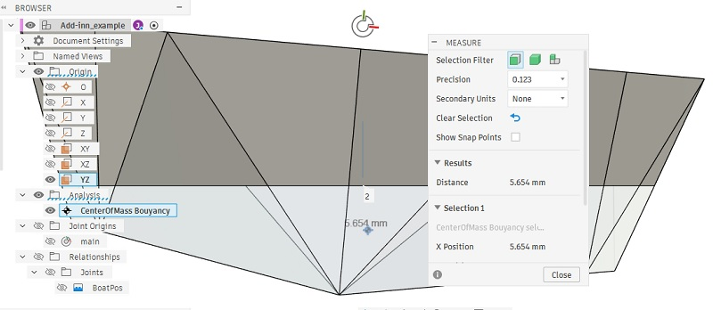

# Calculating staiblity using new tools for Fusion360

We refer to the excelent [Kayak stability therory](https://guillemot-kayaks.com/kayak-stability) guide on Guillemot Kayaks created by Nick Schade. 

Using this as a basis for understanding kayak stability two add-inns for the Computer Aided Design software Fusion360 were developed with the help of its built in AI. 

### Downloads
- [Example file Add-inn_example.f3d](Add-inn_example.f3d)
- [Fusion360 Add-inn RightingArmSweep, requires MassGoalSeekSolver](/Fusion360/RightingArmSweep/RightingArmSweep.zip)
- [Fusion360 Add-inn MassGoalSeekSolver](/Fusion360/MassGoalSeekSolver/MassGoalSeekSolver.zip)

## Overview

- [Mass Goal Seek](#mass-goal-seek) that automatically adjusts a chosen parameter until a chosen
body reaches a target mass, using an iterative secant-method solver. Built to automate finding out how deep a loaded boat hull sits in the water.

- [Righting Arm Sweep](#righting-arm-sweep) A Fusion 360 add-in that sweeps a chosen parameter across a range of values, re-solving a mass target at each step (via the Mass Goal Seek add-in), and logs a resulting world-space measurement to a CSV file — built for generating righting-arm curves for boat hull analysis.

- Example plots of output data:

Used in the [folding kayaks project](./README.md)

Developed by Jakob Rockenberger using Autodesk assistant in 2026.

## Example use case from the [folding kayaks project](./README.md)

- [Example file Add-inn_example.f3d](Add-inn_example.f3d)

The Body representing a boat hull is Joint Offset down into the XY plane that represents sea level.  

The two driving dimensions (Heelangle and Freebord) are renamed using Modify > Change parameters menu. This makes it easier to later find in them in the drop down menus in the Add-inns. 

Then boat hull body is Split and the part that is below "sea level" is renamed "Boyancy_volume" for use in the Mass Goal Seek Add-inn. The Physical material of this bouyancy volume is set to water to accurately represent the bouyancy force. See [Archimedes' principle on wikipedia for why.](https://en.wikipedia.org/wiki/Archimedes%27_principle)

The Mass Goal Seek Add-inn is used to find how deep in the water the boat hull will sit for different loads and heel angles. 

When Mass Goal Seek has been run for a single load and angle configuration, the current [righting arm that makes up the boat hulls stability](https://guillemot-kayaks.com/kayak-stability) can be measured as the distance between the "Center of Mass for the bouyancy volume" and the YZ plane. The model is setup so that it's the X coordinate for the same point, for simplicity.

When a full analysis sweep is needed the Add-inn [Righting arm Sweep](#righting-arm-sweep) is used to drive the Heel Angle and log the resulting righting arms in a CSV file.

[Example CSV output](TestData.csv)

Example plots of (different) output data:

# Mass Goal Seek

## What it does

Given:
- A **parameter** to adjust (e.g. `Freeboard`)
- A **body** to measure (e.g. `bouyancy`)
- A **target mass**

The add-in repeatedly nudges the parameter, recomputes the model, and measures
the body's mass until it converges within a tolerance of the target — removing
the need to manually guess-and-check dimensions to hit a mass target.

## Installation

1. Create a folder named `MassGoalSeekSolver`.
2. Save the add-in's `.py` file and `.manifest` file inside it (same base name
   as the folder).
3. In Fusion: **Utilities → Add-Ins → Scripts and Add-Ins** (`Shift+S`), add the
   `MassGoalSeekSolver` folder under **My Add-Ins**, select it, and click **Run**.
   Check **Run on Startup** to have it load automatically.
4. The command appears as **Mass Goal Seek** under the Utilities tab's Add-Ins panel.

## Dialog inputs

| Field | Description |
|---|---|
| **Parameter** | Dropdown of all parameters in the design. The one that will be adjusted. |
| **Body** | Dropdown of all bodies in the design. The one whose mass is measured. |
| **Target Mass** | Desired mass, entered with units (defaults to kg). |
| **Tolerance (g)** | Acceptable deviation from the target mass, in grams. |
| **Max Iterations** | Safety cap on solver iterations. |
| **Probe Step (mm)** | Initial step size used to estimate sensitivity before the solver's main iterations. |

## How the solver works

1. Reads the current parameter value and body mass.
2. If already within tolerance, stops immediately.
3. Takes one small probe step (in the direction that should move mass toward
   the target) to estimate how sensitive mass is to the parameter.
4. Uses the **secant method** to iteratively converge on the parameter value
   that produces the target mass, recomputing the model at each step.
5. Reports the final parameter value, final mass, number of iterations, and
   whether it converged.

If the probe step produces **zero change in mass** (the parameter doesn't
actually affect that body), the add-in reports this and reverts the parameter
to its original value without modifying the model further.

## Persistence

- **Per-document** (stored in the Fusion file itself via `design.attributes`):
  the last-used **Parameter** and **Body** selections. Reopening the same
  design pre-fills these dropdowns automatically.
- **Per-user** (stored in `mass_goal_seek_settings.json`, created automatically
  next to the add-in script): the last-used **Target Mass**, **Tolerance**,
  **Max Iterations**, and **Probe Step**. These apply as defaults across any
  document you open.

## Limitations

- Only works on parameters that actually drive the measured body's geometry
  (directly or indirectly). If there's no relationship, the solver detects
  zero sensitivity and stops safely.
- Assumes a roughly monotonic relationship between the parameter and mass in
  the region being solved. Highly non-linear or non-monotonic relationships
  may require more iterations or may not converge within `Max Iterations`.
- Designed for single-parameter, single-body goal-seeking — not simultaneous
  multi-variable optimization.

## Related add-in

**Righting Arm Sweep** builds on this add-in: it sweeps a second parameter
(e.g. heel angle) across a range, calling Mass Goal Seek's solver at each step
and logging a resulting measurement (e.g. center of mass) to a CSV for plotting.

# Righting Arm Sweep

A Fusion 360 add-in that sweeps a chosen parameter across a range of values,
re-solving a mass target at each step (via the **Mass Goal Seek** add-in), and
logs a resulting world-space measurement to a CSV file — built for generating
righting-arm (or similar) curves for boat hull analysis.

##  Requires Mass Goal Seek

**This add-in depends on `MassGoalSeekSolver` and will not function without it.**

- `MassGoalSeekSolver` must be installed as a **sibling folder** (same parent
  Add-Ins directory) alongside `RightingArmSweep`. The add-in imports it
  directly as a Python module.
- `MassGoalSeekSolver` must have been **run at least once in the current
  document**, with a parameter and body selected and solved successfully.
  Righting Arm Sweep reads Mass Goal Seek's **persisted settings** for the
  current document (which parameter/body to goal-seek) and for the current
  user (target mass, tolerance, max iterations, probe step) — it does not ask
  for these again.

If `MassGoalSeekSolver` cannot be imported, or has no saved parameter/body for
the active document, Righting Arm Sweep will stop and show a message telling
you to run Mass Goal Seek first.

## What it does

Given:
- A **parameter** to sweep (e.g. `HeelAngle`), with a start value, end value,
  and step
- A **run label** (used as a column header)
- A **CSV file** to write results into

The add-in steps the parameter from start to end, and at each step:
1. Sets the parameter to the current sweep value.
2. Calls Mass Goal Seek's solver (using its persisted parameter/body/target
   settings) to re-converge the mass.
3. Measures the goal-seek body's **world-space** (assembly-context) center of
   mass X coordinate — i.e. its real position in the assembly, accounting for
   any rotation/translation of the component the body lives in.
4. Records the sweep value and the measured X coordinate.

When the sweep finishes, results are merged into the CSV as a new column.

## Installation

1. Create a folder named `RightingArmSweep`, **as a sibling of your existing
   `MassGoalSeekSolver` folder** (both under the same Add-Ins directory).
2. Save the add-in's `.py` file and `.manifest` file inside it (same base name
   as the folder).
3. In Fusion: **Utilities → Add-Ins → Scripts and Add-Ins** (`Shift+S`), add
   the `RightingArmSweep` folder under **My Add-Ins**, select it, and click
   **Run**.
4. The command appears as **Righting Arm Sweep** under the Utilites tab's
   Add-Ins panel.

## Dialog inputs

| Field | Description |
|---|---|
| **Parameter** | Dropdown of all parameters in the design. The one that will be swept. Unit labels on the fields below update automatically based on this selection (e.g. degrees, mm). |
| **Start / End / Step** | The sweep range, in the sweep parameter's own display units. |
| **Run Label** | Text used as the new CSV column header for this run. If it duplicates an existing column, a numeric suffix is auto-appended, e.g. `Run 1 (2)`. |
| **CSV Path** | Path to the output CSV. Use **Browse...** to pick or create a file. |

## CSV output format

Results are stored **wide-format**, one column per run, keyed by the swept
value (rounded to 3 decimal places) so multiple runs with the same range align
into the same rows.

- Each new run adds a column; existing columns and rows are preserved.
- If a run's swept values don't match previously logged values exactly, new
  rows are added and unmatched cells are left blank.

## Progress and cancellation

- A progress dialog shows which point is currently being solved
  (`Solving point X of Y (Parameter = value)`).
- A **Cancel** button is available. If clicked, the sweep stops after the
  current point; whatever points were already solved are still written to the
  CSV, and the summary message notes the run was cancelled.

## Write-access checks

Before starting the sweep, and again right before saving results, the add-in
checks that the CSV file can actually be written to (e.g. not open in Excel,
not read-only, parent folder exists). If the file becomes locked mid-sweep,
solved points are reported but not silently lost — you'll be told how many
points were solved and asked to free the file and try again.

## Parameter restoration

After the sweep completes — or is cancelled — the swept **parameter** is
automatically restored to the value it had before the sweep started. Note that
this only applies to the swept parameter itself; the Mass Goal Seek target
parameter (e.g. `Freeboard`) is left at whatever value converged for the last
solved point, since it's a dependent result of the sweep, not a value you set
directly.

## Persistence

- **Per-document** (via `design.attributes`): the last-used **Parameter**
  selection for the sweep.
- **Per-user** (via `righting_arm_sweep_settings.json`, created next to the
  add-in script): the last-used **Start**, **End**, **Step**, **Run Label**,
  and **CSV Path**.

Mass Goal Seek's own settings (target mass, tolerance, etc.) are read directly
from *its* persisted settings — Righting Arm Sweep does not duplicate or
override them.

## Limitations

- Requires `MassGoalSeekSolver` installed as a sibling folder and already
  configured/run once for the active document (see warning above).
- World-space center-of-mass calculation assumes the measured body lives
  inside an **occurrence** with a transform relative to the root component.
  If the body is directly in the root component (no occurrence), its
  component-local and world-space values are the same.
- Large sweeps (many points, each requiring several solver iterations) can
  take a noticeable amount of time — the progress dialog's Cancel button is
  there for exactly this case.

Back to 
- [Folding kayaks project README](/README.md)
- [Folding kayaks project Research](/research.md)