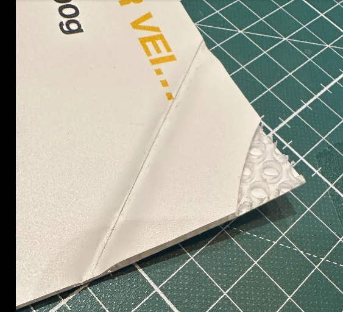
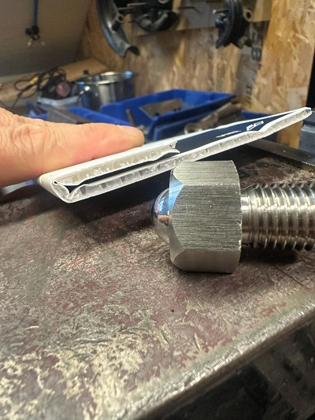
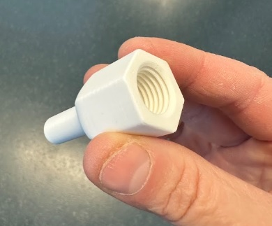
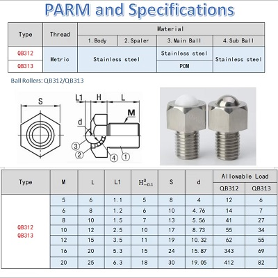
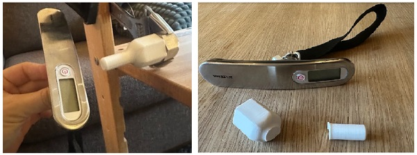
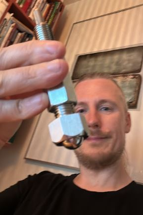
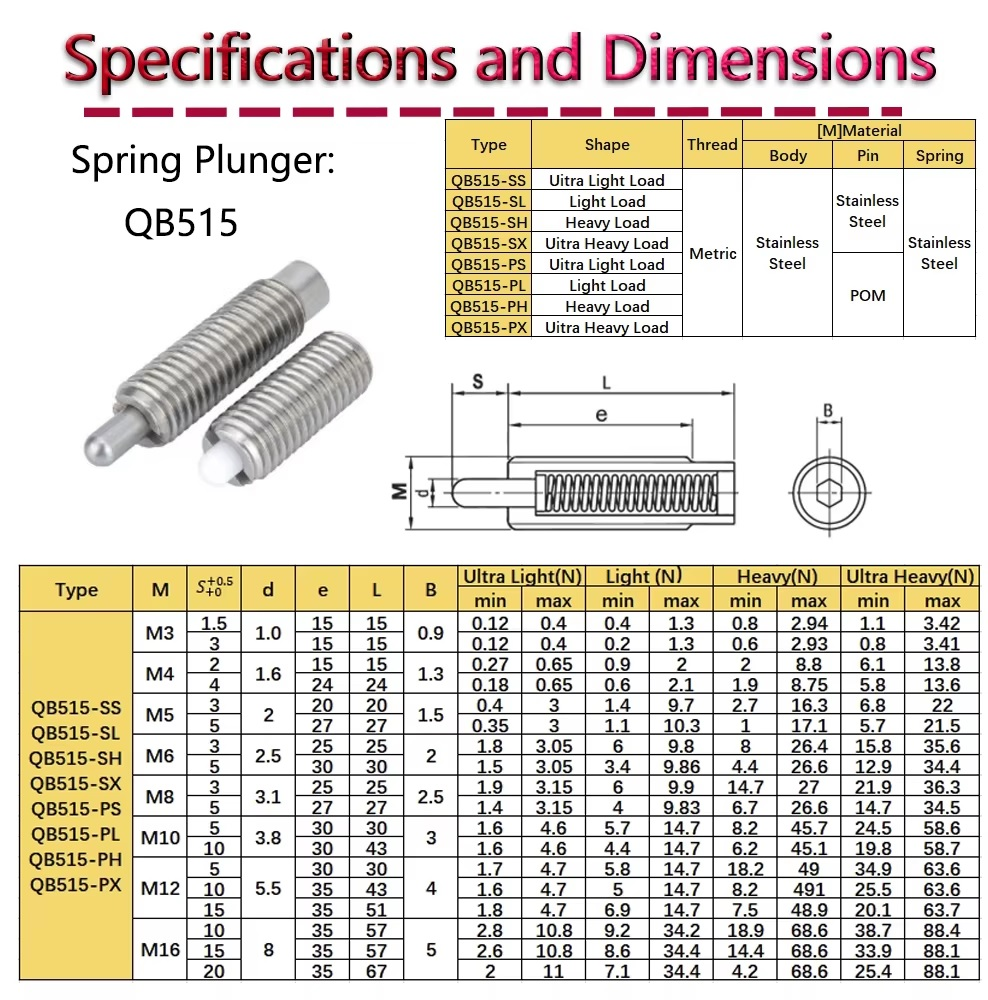
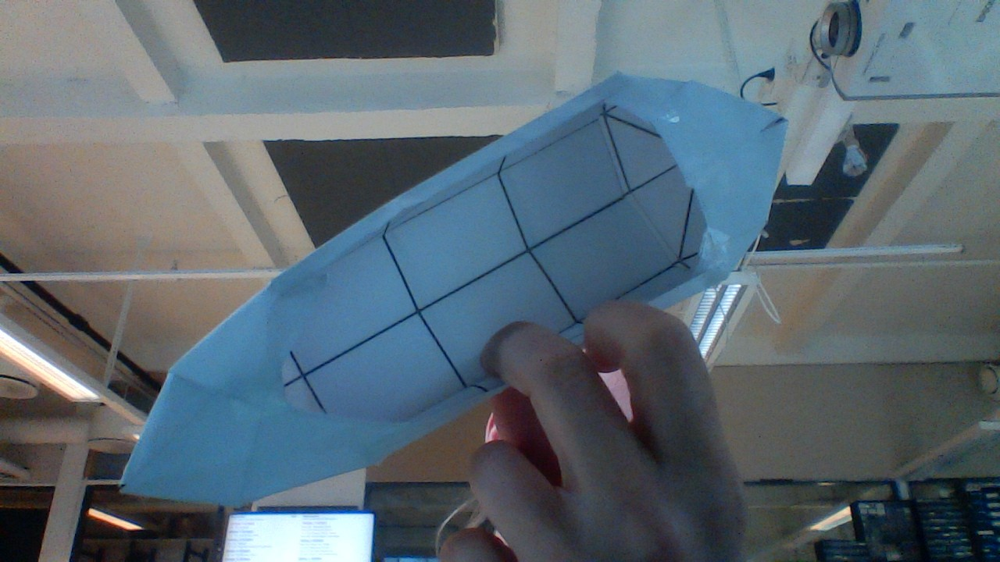
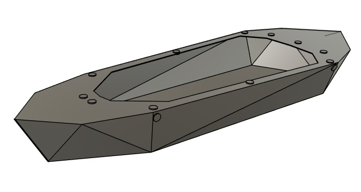
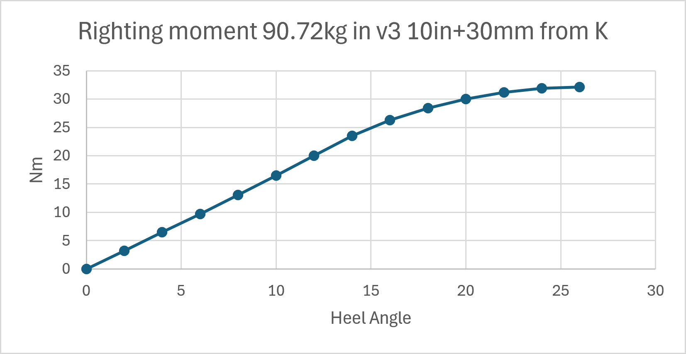

# Research

## Ongoing areas of research for the [folding kayak project](README.md#folding-kayak).
- An [autocreaser](#autocreaser) is being developed.
- Tests of [alternative sheets type](#alternative-sheet-test) to the channeled one
- Develop [version 3](#version-3), a new "higher poly count" look of the folding kayak
- Test out low seats with backs like [Falkeberg Ground Chair](./Images/ground_chair.JPG)

## Finished research
- [Stability- and Righting arm-analysis tools for Fusion360](/Fusion360/FusionAddinns.md)
- [A sheet metal approximation](sheet_metal_theory.md#motivation)

# Sheet materials

The only material we have full size tests of so far is channeled 4mm thickness 700g/m^2 polypropylene. Supplied by [Antalis](https://www.antalis.no/eshop/medier-og-utstyr-for-visuell-kommunikasjon/plater/kanalplast-pp-pdp-hq08108/sku-694530#)

## Alternative sheet tests
- [Akyprint smooth 3.3mm 900g/m from VINK](https://vink.no/media/import/NO_Akyprint_Brosjyre.pdf), works great in small scale test!

Worked great with the [autocreaser](#autocreaser), more pics there.

## Untesteded, potential sheets 
- Akylite 600g/m^2 2.9 mm med bobler. Possibly too thin and weak. Suppliers:
    - [VINK](https://vink.no/nettbutikk/plater/lettvektsplater.html?cat=14930)
    - [GOP](https://www.gop.se/no/industri/industriprodukter/pp-no/akylite/) 
- AKYPRINT® UV 4 mm 1300 gr/m² 
    - [GOP](https://www.gop.se/no/industri/industriprodukter/pp-no/)
    - [VINK](https://vink.no/akyprint-akylite/)

- Akyboard D4 3.5 mm 1000 g/m² or
Akyboard® D4 4 mm 1500 g/m² 
    - [GOP](https://www.gop.se/no/industri/industriprodukter/pp-no/akyboard/)

[Akyboard D4 bubble/hex structure brochure](https://www.sunclear.fr/img/medias/bt/POLYPROPYLENE_ALVEOLAIRE__AKYDRIVE_FLOORING_fiche_technique_240821.pdf) *looks to have tightly packed bubbles/hexes*
    
All Aky**** sheets are being renamed Akyboard by the manufacturer [Corplex](https://corplex.com/industries/display/)    
- AkyBoard® Print (formerly AkyPrint®)
- AkyBoard® Print Lite panels (formerly AkyLite®)

See also [Corplex info page](https://corplex.com/plastic-sheets/bubble/)

# Autocreaser

The goal is to be able to use a large CNC machine to automate the creasing of polypropylene sheets when [folding kayaks.](./README.md)

Successfull test at [Bitraf](https://bitraf.no/)!

Sheet used: [Akyprint smooth 3.3mm 900g/m from VINK](https://vink.no/media/import/NO_Akyprint_Brosjyre.pdf) with a Ø16mm free rolling ball driven at a fixed height, no heat needed.

Verified double crease line center-center spacing 6.7mm with a 3.3 mm thich sheet. Gives better result than the picture above.

[Youtube short, autocrease test](https://youtube.com/shorts/zlMBDUQS9Cw)

Next test will be using a CNC and the leftover sheet of channeled polypropylene. (The bubble one would probably be even better. But we have it already.)

## BOM
- Adapter for creasing ball [Fusion360](https://a360.co/4yF22JU) or [STL-file for printing](3D-print-STL/Adapter.stl)
- Conveyor Ball Roller QB312, M16 from [Aliexpress](https://www.aliexpress.com/item/1005005415776359.html)

The 3D-printed Ø12mm adapter can act as a break-away if we have ha catastrophic collison. 

When printed in PLA with 12 perimeters (acts as 100% infill) it could withstand 35kg sideways static force before snapping. Snapped around 36kg load.

## Working principle 

- Mount Ø16mm ball with Ø12mm adapter in spindle collet on shopbot CNC
- Fix the sheet with tape
- Adjust the Z-offset to control the pressure on the sheet
- Crease one side at a time

## First prototype

The spring pin was not smooth enought when exposed to sideways forces.

- Ø8mm Steel spring pin QB515-SH, M16 from [Aliexpress](https://www.aliexpress.com/item/1005006329455989.html)

# Version 3 

Under development. 

Change log
- Introduces more angles to the first pack up lines, makes a rounder more complex shape. 

Next step:
- Make new paper tests 

Only tested in paper.

- [PDF drawing for A4 models](Drawings/V3_1Oct_double_top.pdf)

- [3D-model, web view](https://a360.co/4iS6Kz8) Including a comparison with v2 and a righting arm analysis setup

Righting arm vs Heel angle plot for different loads. Centre of gravity 254mm (10in = standard pilot assumption) + 30mm (assumed seat height) above keel.

- [Graph data CSV](Fusion360/TestData_v3_comp.csv)
- [Graph data Excel](Fusion360/RightingArmSweep_cleaned_plotted.xlsx)
- [Solo Microbootlegger kayak](https://guillemot-kayaks.com/catalog/strip-built/recreational-kayak-solo/solo-microbootlegger) used as comparision

- [DXF pattern](Drawings/Simple_pattern_v3_top_lines.dxf)
