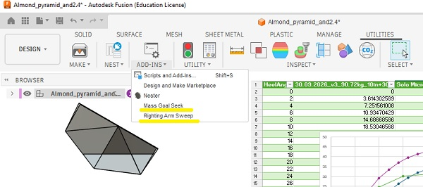

# Research

## Ongoing areas of research for the [folding kayak project](README.md#folding-kayak).
- An [autocreaser](#autocreaser) is being developed.
- Tests of [alternative sheets type](#alternative-sheet-test) to the channeled one
- Develop [version 3](#version-3), a new "higher poly count" look of the folding kayak
- Test out low seats with backs like [Falkeberg Ground Chair](./Images/ground_chair.JPG)

## Previous research
- Stability- or Righting arm-analysis
- [A sheet metal approximation](sheet_metal_theory.md#motivation)

# Alternative sheet test

- [Akyprint smooth 3.3mm 900g/m from VINK](https://vink.no/media/import/NO_Akyprint_Brosjyre.pdf), works great in small scale test!

# Autocreaser

The goal is to be able to use a large CNC machine to automate the creasing of polypropylene sheets when [folding kayaks.](./README.md)

Successfull test at [Bitraf](https://bitraf.no/)!

Sheet used: [Akyprint smooth 3.3mm 900g/m from VINK](https://vink.no/media/import/NO_Akyprint_Brosjyre.pdf) with a Ø16mm free rolling ball driven at a fixed height, no heat needed.

Verified double crease line center-center spacing 6.7mm with a 3.3 mm thich sheet. Gives better result than the picture above.

[Youtube short, autocrease test](https://youtube.com/shorts/zlMBDUQS9Cw)

Next test will be using a CNC and the leftover sheet of channeled polypropylene. (The bubble one would probably be even better. But we have it already.)

## BOM
- Adapter for creasing ball [Fusion360](https://a360.co/4yF22JU) or [STL-file for printing](3D-print-STL/Adapter.stl)
- Conveyor Ball Roller QB312, M16 from [Aliexpress](https://www.aliexpress.com/item/1005005415776359.html)

The 3D-printed Ø12mm adapter can act as a break-away if we have ha catastrophic collison. 

When printed in PLA with 12 perimeters (acts as 100% infill) it could withstand 35kg sideways static force before snapping. Snapped around 36kg load.

## Working principle 

- Mount Ø16mm ball with Ø12mm adapter in spindle collet on shopbot CNC
- Fix the sheet with tape
- Adjust the Z-offset to control the pressure on the sheet
- Crease one side at a time

## First prototype

The spring pin was not smooth enought when exposed to sideways forces.

- Ø8mm Steel spring pin QB515-SH, M16 from [Aliexpress](https://www.aliexpress.com/item/1005006329455989.html)

# Kayak stability

We refer to the excelent [Kayak stability therory](https://guillemot-kayaks.com/kayak-stability) guide on Guillemot Kayaks created by Nick Schade. 

Using this as a basis for understanding kayak stability two add-inns for the Computer Aided Design software Fusion360 were developed with the help of built in AI. 

### Downloads
- [Example file Add-inn_example.f3d](Add-inn_example.f3d)
- [Fusion360 Add-inn RightingArmSweep, requires MassGoalSeekSolver](./Fusion360/RightingArmSweep/RightingArmSweep.zip)
- [Fusion360 Add-inn MassGoalSeekSolver](./Fusion360/MassGoalSeekSolver/MassGoalSeekSolver.zip)

# Version 3 

Under development. 

Change log
- Introduces more angles to the first pack up lines, makes a rounder more complex shape. 

Next step:
- Make new paper tests 

Only tested in paper.

- [PDF drawing for A4 models](Drawings/V3_1Oct_double_top.pdf)

- [3D-model, web view](https://a360.co/4iS6Kz8) Including a comparison with v2 and a righting arm analysis setup

Righting arm vs Heel angle plot for different loads. Centre of gravity 254mm (10in = standard pilot assumption) + 30mm (assumed seat height) above keel.

- [Graph data CSV](Fusion360/TestData_v3_comp.csv)
- [Graph data Excel](Fusion360/RightingArmSweep_cleaned_plotted.xlsx)
- [Solo Microbootlegger kayak](https://guillemot-kayaks.com/catalog/strip-built/recreational-kayak-solo/solo-microbootlegger) used as comparision

- [DXF pattern](Drawings/Simple_pattern_v3_top_lines.dxf)
